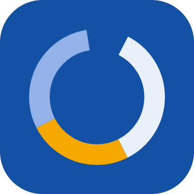

<p align="center"></p>

# MarketHeist MCP server

**Analyze portfolios that hold other portfolios and strategies, backtest trading rules, and look up cited portfolio returns, risk and factors, on real price history.**

MarketHeist is a free, public, remote MCP server. Put whole portfolios, a trend-filtered strategy or a rotation inside one portfolio, add a filter on top, and get CAGR, drawdown and Sharpe from real price history with caveats. It also backtests indicator rules on any ticker, decomposes funds into factors, and answers lookups (seasonality, calendar-year returns, drawdowns, diversification, comparisons, fund history) for 19 model portfolios and 7 strategies from precomputed data that cites the marketheist.io page with the same number.

- **Endpoint:** `https://api.marketheist.io/api/mcp` (Streamable HTTP)
- **Auth:** none. No account, no API key.
- **Tools:** ten, all read-only.
- **Version:** 1.2.0
- **Docs:** https://marketheist.io/docs/reference/mcp
- **Privacy:** https://marketheist.io/docs/privacy
- **Registry name:** `io.marketheist/backtest` in the [official MCP Registry](https://registry.modelcontextprotocol.io)

This repository holds the connection instructions and manifests only. The server is a hosted service, so there is nothing to install or build.

## Connect

There is nothing to install. Add the URL to your client.

**Claude Code**

```bash
claude mcp add --transport http marketheist https://api.marketheist.io/api/mcp
```

**Claude (claude.ai and Desktop):** Settings → Connectors → Add custom connector → paste `https://api.marketheist.io/api/mcp`.

**Cursor** (`~/.cursor/mcp.json` or `.cursor/mcp.json`)

```json
{
  "mcpServers": {
    "marketheist": { "url": "https://api.marketheist.io/api/mcp" }
  }
}
```

**VS Code** (`.vscode/mcp.json`)

```json
{
  "servers": {
    "marketheist": { "type": "http", "url": "https://api.marketheist.io/api/mcp" }
  }
}
```

**Cline** (`cline_mcp_settings.json`)

```json
{
  "mcpServers": {
    "marketheist": {
      "type": "streamableHttp",
      "url": "https://api.marketheist.io/api/mcp",
      "disabled": false,
      "autoApprove": []
    }
  }
}
```

**Gemini CLI**

```bash
gemini extensions install https://github.com/marketheist/mcp
```

Or add it to `~/.gemini/settings.json`:

```json
{
  "mcpServers": {
    "marketheist": { "httpUrl": "https://api.marketheist.io/api/mcp" }
  }
}
```

**Clients that only speak stdio** (bridge through `mcp-remote`)

```json
{
  "mcpServers": {
    "marketheist": { "command": "npx", "args": ["-y", "mcp-remote", "https://api.marketheist.io/api/mcp"] }
  }
}
```

**Anything else:** Streamable HTTP at `https://api.marketheist.io/api/mcp`, JSON-RPC over POST, no authentication.

## What makes it different

- **Holdings can be portfolios or strategies, not only funds.** Put Golden Butterfly and All Weather inside one portfolio next to QQQ, make the stock half of a 60/40 a trend-filtered S&P 500, or hold a rotation that picks the strongest of SPY, EFA and BND each month.
- **Filters on top.** A trend filter can wrap the whole book (hold it only while it is above its own 10-month average, else cash) or one holding.
- **Same numbers as a plain portfolio.** Nested results come with the same CAGR, drawdown, Sharpe, risk split, caveats and reproduce hash.
- **The baseline is still there.** Plain buy-and-hold and rebalanced mixes (16 built-in lazy portfolios or any tickers) work as usual.

## Tools

`static` tools answer from precomputed data bundled with the server: instant, with the month the data runs through and the page to cite.

| Tool | Kind | What it does |
|---|---|---|
| `portfolio_returns` | static | Seasonality by calendar month with t-statistics, calendar-year returns (partial years labelled, S&P 500 beside them) and trailing returns for a model portfolio, strategy or fund. |
| `portfolio_risk` | static | Deepest drawdowns with recovery times, Ulcer, VaR/CVaR, share of risk vs share of money, independent bets over four periods, near-duplicate holdings and correlations. |
| `compare_portfolios` | static | Two to four portfolios side by side over their common window: CAGR, volatility, drawdown, Sharpe, Sortino, correlation and calendar years. |
| `analyze_portfolio` | static for ids, live for custom | Analyzes a lazy portfolio, a ready-made strategy, any ticker mix, or a multi-strategy portfolio whose holdings are whole portfolios, backtested strategies or rotations, with an optional trend filter on the whole book. |
| `find_guides` | static | Searches 90 research pages (strategies, fund history, trend filters, risk, rule robustness) and returns each page's verdict, headline numbers, data month and link. |
| `list_portfolios` | static | Lists the 19 model portfolios, 7 canonical strategies and 19 library strategies with holdings, headline numbers and page links. |
| `fund_history` | static | How far back a fund can be tested, its proxy chain and how closely each stand-in tracked it. |
| `decompose_factors` | static for ids, live for tickers | Regresses a ticker's or a portfolio's returns on market, size, value, momentum, quality, low-volatility, duration and credit factors. |
| `run_backtest` | live | Backtests one indicator rule on any ticker (daily, weekly or monthly) against buy-and-hold, with a validity block and an overfit check. |
| `list_indicators` | static | Lists the 12 built-in technical indicators with parameters and default rules. |

## Try asking

1. "Build me a portfolio of portfolios: 40% Golden Butterfly, 40% All Weather and 20% QQQ, rebalanced yearly. Then add a 10-month trend filter on the whole thing."
2. "Make the stock side of a 60/40 a trend-following S&P 500 (in SPY above its 10-month average, else cash) and keep the bonds plain. Compare with an ordinary 60/40."
3. "Analyze the All Weather portfolio with a 10-month trend filter. How much did it cut the drawdown?"
4. "I hold 60% VTI, 20% VXUS and 20% BND, rebalanced yearly. How has that done, and where does the risk come from?"
5. "Backtest a 50/200-day golden cross on SPY with daily data and 5 bps costs, against buy-and-hold."
6. "What is ARKK actually exposed to? Decompose its returns into factors."
7. "Is September a bad month for the 60/40 portfolio?"
8. "Is 60/40 really diversified, and how did All Weather do in 2022?"
9. "Compare 60/40, All Weather and Golden Butterfly over the same period."
10. "How far back can I test VXUS?"

## How the numbers are made

Every number is computed by a deterministic engine on real price data (Yahoo Finance adjusted closes, dividends reinvested), not estimated by the model. Each result carries a validity block: data provenance and window, known caveats (single historical path, no costs or taxes unless set, proxy-extended history, statistical significance, a parameter-overfit check) and a reproduce hash.

Historical simulation for research and education, not investment advice.

## Contact

support@marketheist.io · https://marketheist.io
